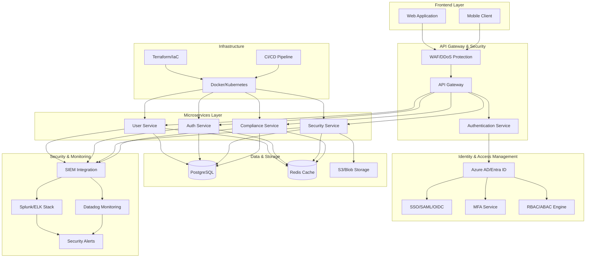
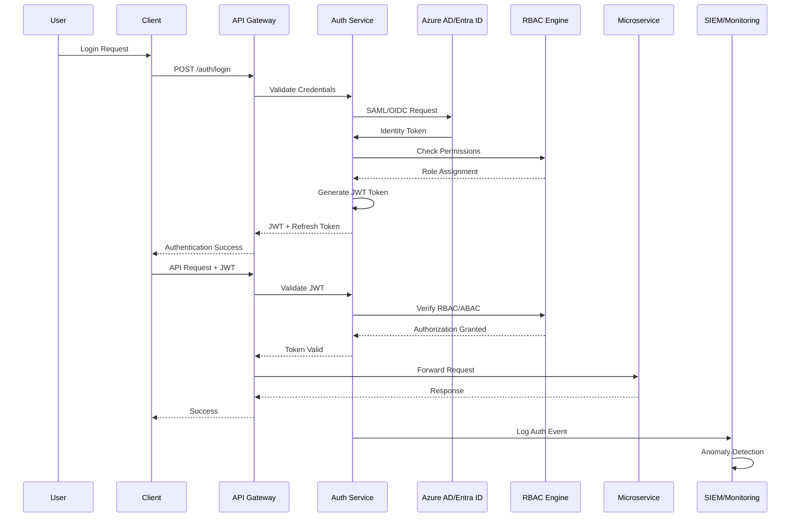
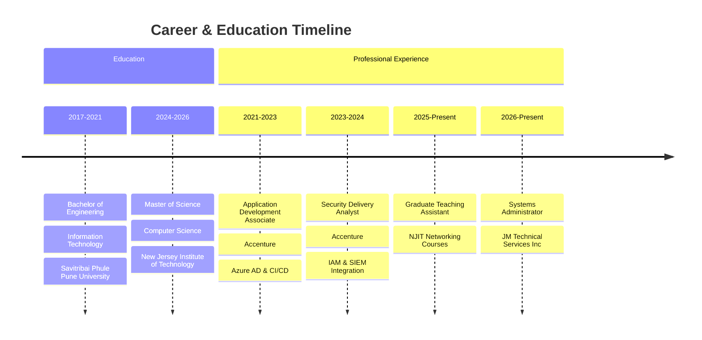
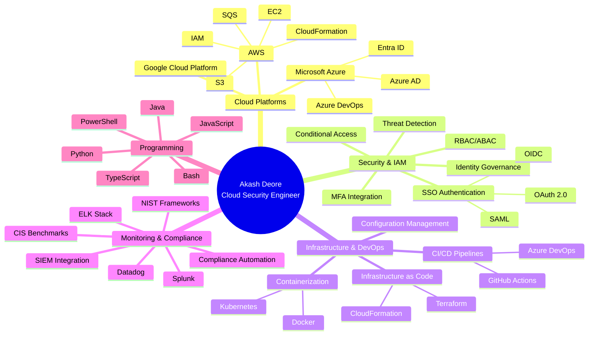

  

  
  
  
  
  
  
   
  
  
  

---

## 🎯 Professional Summary

**Cloud Security Engineer** with **4+ years** of enterprise-grade experience delivering secure, scalable cloud infrastructure solutions across **AWS, Azure, and GCP**. Deep expertise in **Identity and Access Management (IAM)**, **Infrastructure as Code (IaC)**, and **security automation** aligned with **NIST frameworks** and **CIS Benchmarks**. Proven track record of reducing security incidents by **65%** through automated IAM governance pipelines and cutting infrastructure costs by **$16K+** while maintaining **99.9% data integrity**.

Completed my**Master of Science in Computer Science** at **New Jersey Institute of Technology** (Expected May 2026) while serving as a **Graduate Teaching Assistant** for networking courses. Former **Security Delivery Analyst** at **Accenture**, where I architected RBAC/ABAC frameworks, implemented SSO authentication flows, and built Python-based SIEM integrations that increased threat detection by **40%**.

**Core Competencies:** Cloud Security Architecture • IAM & Identity Governance • Infrastructure Automation • DevSecOps • Microservices Architecture • Compliance Engineering • Incident Response • Security Monitoring

---

## 🏗️ Cloud Security Architecture

---

## 🔐 IAM Authentication Flow

---

## 📊 Professional Journey

---

## 💼 Professional Experience

### 🔹 Systems Administrator
**JM Technical Services Inc.** | *Jan 2026 - Present*

- 🚀 **Infrastructure Automation:** Provisioned scalable cloud infrastructure using **Infrastructure as Code (IaC)** principles with **Terraform** and **CloudFormation**, reducing deployment lead time by **20%** and enforcing security baselines for standardized account provisioning
- 🛡️ **Compliance Engineering:** Implemented automated compliance validation and security policy enforcement across multi-cloud environments, ensuring alignment with **NIST frameworks** and **CIS Benchmarks**
- 💾 **Disaster Recovery:** Engineered **Disaster Recovery (DR)** strategies for system migrations, ensuring **99.9% data integrity** and supporting business continuity for critical enterprise workflows
- 💰 **Cost Optimization:** Led technical evaluations and optimized cloud/on-premise resources, resulting in approximately **$16K reduction** in infrastructure costs while maintaining high availability

**Technologies:** Infrastructure as Code, Terraform, CloudFormation, NIST, CIS Benchmarks, Disaster Recovery

---

### 🔹 Security Delivery Analyst
**Accenture** | *Mar 2023 - Mar 2024*

- 🔐 **Identity Automation:** Automated secure access provisioning and identity governance pipelines using **Azure AD (Entra ID)** and **PowerShell**, eliminating manual bottlenecks and reducing identity-related incidents by **65%**
- 🎯 **Access Control Frameworks:** Implemented **RBAC/ABAC** access control frameworks and **SSO** authentication flows (**SAML/OIDC/OAuth 2.0**), improving compliance audit scores by **35%** and enforcing least privilege access across cloud environments
- 🔍 **Threat Detection:** Designed and deployed **Python-based APIs** integrated with **SIEM platforms** to detect IAM anomalies, increasing threat detection capabilities by **40%** and resolving security visibility gaps
- 🤝 **Cross-Functional Collaboration:** Collaborated with engineering stakeholders to align cloud security architectures with business objectives, achieving a **15% reduction** in operational costs

**Technologies:** Azure AD, Entra ID, PowerShell, RBAC, ABAC, SSO, SAML, OIDC, OAuth 2.0, Python, SIEM, IAM

---

### 🔹 Application Development Associate
**Accenture** | *Sep 2021 - Feb 2023*

- 👤 **Identity Lifecycle Management:** Managed **Azure AD (Entra ID)** and **Active Directory** identity lifecycles, including configuring **Conditional Access policies**, **MFA integration**, and automated compliance checks, maintaining **100% uptime** for identity workflows
- 🔄 **DevSecOps Pipelines:** Built **CI/CD pipelines** from scratch using **Azure DevOps** and **GitHub Actions**, integrating security controls for shift-left validation and enhancing deployment reliability by **45%**
- 🐳 **Container Orchestration:** Orchestrated containerized deployments using **Docker** and container orchestration tools, enhancing system reliability and decreasing release failures by **33%**

**Technologies:** Azure AD, Entra ID, Active Directory, MFA, CI/CD, Azure DevOps, GitHub Actions, Docker, Kubernetes

---

### 🔹 Graduate Teaching Assistant
**New Jersey Institute of Technology** | *Jan 2025 - Dec 2025*

- 📚 **Technical Instruction:** Facilitated technical troubleshooting for networking concepts including **TCP/IP**, **DNS**, and protocol analysis, delivering hands-on guidance to improve student comprehension
- 🎓 **Curriculum Support:** Assisted in course material development and provided mentorship for graduate-level computer science students

**Technologies:** TCP/IP, DNS, Network Protocol Analysis

---

## 🛠️ Technology Stack

### **Cloud Platforms & Infrastructure**

### **Security & Identity Management**

### **Infrastructure as Code & DevOps**

### **Monitoring & Observability**

### **Programming & Scripting**

### **Databases & Storage**

### **Frameworks & APIs**

---

## 🎯 Technical Expertise Breakdown

---

## 🚀 Featured Projects

### 🔐 Cloud Security User Management System

**Secure, Role-Based Authentication Platform with Automated CI/CD**

A production-grade user management system implementing enterprise security patterns with JWT-based authentication,
